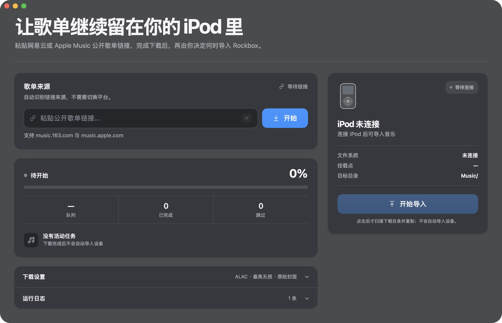

# Music Bridge

**让歌单继续留在你的 iPod 里。**

用于歌单下载与 Rockbox iPod 手动导入的原生 macOS 应用。粘贴网易云或 Apple Music 公开歌单链接，通过本地下载工具取得音乐，再由你决定何时复制到设备。

[English](README.md) · 简体中文

> 当前为源码测试版，软件界面使用简体中文。真实歌单下载与实体 iPod 导入尚未完成端到端验证。



*在 Apple Silicon、macOS 27.2 上从实际运行的应用采集。画面为未连接设备、没有活动任务的状态。*

## 功能

- **歌单识别**：支持网易云与 Apple Music 公开歌单链接。网易云歌曲信息会匹配到 Apple Music 中国区目录，无法确认的版本会跳过。
- **本地下载**：调用单独配置的 `amdl` 和 wrapper-lite 服务，提供进度、取消及有长度上限的日志。
- **无损音质设置**：选择最高 192 kHz 或 48 kHz 的 ALAC 上限，并保存音质和封面偏好。实际质量取决于可用音源。
- **手动导入 iPod**：读取真实挂载设备信息，仅允许向可写且受支持的设备导入。下载完成后不会自动复制到设备。
- **文件保护**：检查路径、符号链接与设备卷标识，使用临时文件完成复制；同路径且大小相同的文件跳过，大小不同的已有文件保留。
- **原生桌面界面**：SwiftUI 与 AppKit、macOS 红绿灯、半透明材质、鼠标光斑和小幅卡片浮动，响应“减少动态效果”“减少透明度”“增强对比度”。

### 鼠标光斑


*由四张实际应用画面组成的慢速悬停状态序列，并非实时帧率录屏。上方完整截图展示窗口控件，此处特写展示歌单来源板块。*

## 构建与运行

需要 macOS、Swift 6 或更新版本及 macOS SDK。包声明的最低运行版本为 macOS 14，构建与启动已在 Apple Silicon、macOS 27.2 上验证；较旧系统尚未实测。

在仓库根目录执行：

```sh
bash script/build_and_run.sh --verify
```

脚本会生成并打开 `dist/MusicBridgeApp.app`。仅构建界面不需要下载服务。本版尚未进行 Developer ID 签名或公证，也未提供安装包。

## 配置下载环境

按照上游说明分别配置 [amdl 下载器](https://github.com/zhaarey/apple-music-downloader) 与 [wrapper-lite 服务](https://github.com/WorldObservationLog/wrapper/tree/lite)。以下路径均相对于项目根目录：

| 路径 | 用途 |
| --- | --- |
| `amdl` | 下载器可执行文件 |
| `config.yaml` | 个人下载器配置 |
| `work/wrapper-lite-macos/start-local.sh` | 本地 wrapper 启动脚本 |
| `work/wrapper-lite-macos/` | wrapper 与 QEMU 运行文件 |

本地 wrapper 地址为 `http://127.0.0.1:12340`。实际下载需要有效登录、本地服务就绪和可访问的歌单。音频检查还需要 `ffprobe`，可随 FFmpeg 安装。

应用应保留在项目根目录的 `dist/` 下，以便找到运行依赖。移动项目后重新构建。认证磁盘、个人配置、下载音乐、日志和构建产物均排除在版本管理之外。

## 导入 iPod

1. 连接已挂载且可写的 Rockbox iPod。
2. 使用配置好的本地工具下载音乐。
3. 点击“开始导入”，扫描下载目录并复制到设备的 `Music/` 目录。

设备断开、只读或写入权限不明时不能导入。大小不同的已有文件不会被覆盖；文件大小相同仅是跳过规则，不代表内容已经确认一致。`ffprobe` 检查通过也不保证在每台 Rockbox 设备上都能播放。

## 检查与当前限制

```sh
bash script/check.sh
```

独立 Swift 检查程序覆盖链接验证、任务取消、下载参数、音质与封面设置、导入门禁、路径与符号链接边界、旧回调、进程输出和鼠标输入边界。检查使用临时文件及注入的服务响应，不登录账号、不下载音乐，也不写入实体设备。

完整下载和实体设备导入流程仍待端到端验证。外部服务可能变化，音源可用性及匹配结果也会因地区和发行版本而不同。

## 隐私与许可

网易云歌单链接会发送至第三方 GoMusic 服务。Apple Music 匹配会访问 Apple 的公开网页与目录接口。登录凭据及订阅访问由外部工具管理。

请仅处理你有权访问的音乐。源码采用 [MIT 许可证](LICENSE)，依赖、素材及商标来源见 [第三方声明](THIRD_PARTY_NOTICES.md)。
